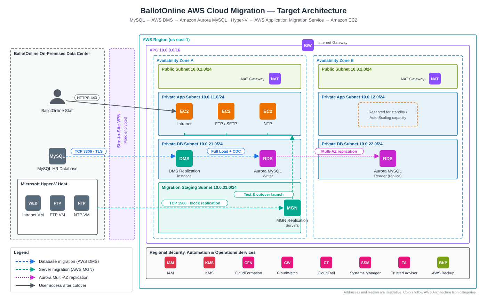

# Diagrams

| File | Description |
|---|---|
| [`aws-target-architecture.svg`](aws-target-architecture.svg) | Target AWS architecture: on-premises MySQL and Hyper-V, Site-to-Site VPN, VPC across two Availability Zones, DMS → Aurora and MGN → EC2 migration paths, and regional security/operations services. |

The diagram is plain SVG, so it renders on GitHub and can be edited in any text editor or imported into draw.io.
