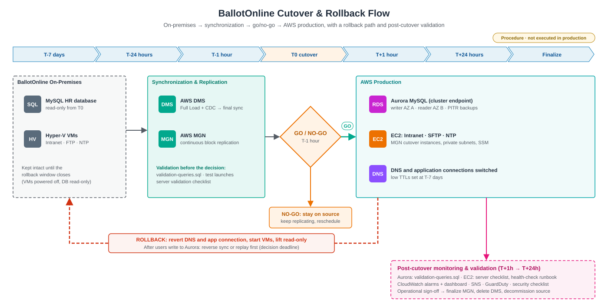
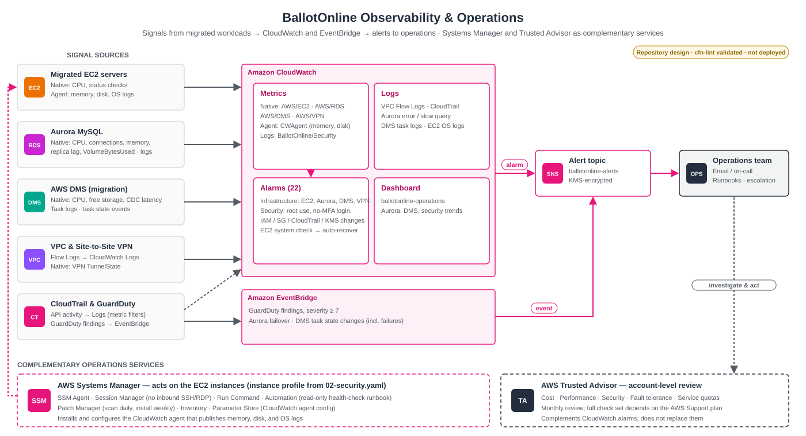

# 🏗️ BallotOnline AWS Cloud Migration Architecture


## Overview

This document describes the target cloud architecture developed for the BallotOnline migration project. The migration moves selected workloads from the existing on-premises environment to Amazon Web Services (AWS).

Two primary migration strategies are used:

| Workload | Source | Target | Strategy | Migration Service |
|---|---|---|---|---|
| HR Database | MySQL | Amazon Aurora MySQL | Replatform | AWS DMS |
| Intranet Server | Hyper-V | Amazon EC2 | Rehost | AWS Application Migration Service |
| FTP Server | Hyper-V | Amazon EC2 | Rehost | AWS Application Migration Service |
| NTP Server | Hyper-V | Amazon EC2 | Rehost | AWS Application Migration Service |

The architecture is presented in three stages:

1. **Before migration** — the existing on-premises environment
2. **During migration** — the hybrid state while data and servers replicate to AWS
3. **After migration** — the target AWS environment

> **Note:** IP ranges, instance sizes, and names in this document are illustrative. No real account IDs, endpoints, or addresses are included.

---

## 1. Existing On-Premises Environment

Before migration, BallotOnline operates infrastructure in an on-premises environment.

```text
┌────────────────────────────────────────────────────────────────────┐
│                      BALLOTONLINE ON-PREMISES                      │
│                                                                    │
│  ┌─────────────────┐          ┌─────────────────┐                  │
│  │ MySQL HR        │          │ Microsoft       │                  │
│  │ Database        │          │ Hyper-V Host    │                  │
│  └─────────────────┘          └────────┬────────┘                  │
│                                        │                           │
│                      ┌─────────────────┼─────────────────┐         │
│                      │                 │                 │         │
│                 ┌────┴─────┐      ┌────┴─────┐      ┌────┴─────┐   │
│                 │ Intranet │      │   FTP    │      │   NTP    │   │
│                 │  Server  │      │  Server  │      │  Server  │   │
│                 └──────────┘      └──────────┘      └──────────┘   │
│                                                                    │
└────────────────────────────────────────────────────────────────────┘
```

### Current-State Limitations

| Area | Limitation |
|---|---|
| Scalability | Capacity is bound to physical Hyper-V hardware. |
| Availability | Single site; hardware failure affects every workload on the host. |
| Database operations | Backups, patching, and replication are managed manually. |
| Security | Perimeter-based; limited centralized identity and audit logging. |
| Monitoring | No centralized metrics, logs, or alerting. |
| Disaster recovery | No secondary site; recovery depends on local backups. |

The objective is to migrate these workloads to AWS while improving scalability, availability, security, monitoring, and operational efficiency.

---

## 2. Database Migration Architecture

The HR MySQL database uses a **replatforming** strategy.

Rather than maintaining the database on a traditional virtual machine, the target platform is **Amazon Aurora MySQL**, providing a managed relational database environment with automated backups, patching, storage scaling, and Multi-AZ replicas.

### Migration Flow

```text
┌───────────────────┐
│ On-Premises MySQL │
│    HR Database    │
└─────────┬─────────┘
          │
          │ Secure Network Connectivity
          │ (Site-to-Site VPN, TLS, TCP 3306)
          ▼
┌──────────────────────────┐
│ AWS Database Migration   │
│ Service (AWS DMS)        │
│                          │
│ • Source Endpoint        │
│ • Replication Instance   │
│ • Full Load              │
│ • CDC                    │
│ • Target Endpoint        │
└────────────┬─────────────┘
             │
             ▼
┌──────────────────────────┐
│ Amazon Aurora MySQL      │
│ Target Database          │
└──────────────────────────┘
```

### Migration Process

1. Configure the source MySQL database (binary logging in `ROW` format, a dedicated replication user).
2. Provision the Aurora MySQL target.
3. Configure AWS DMS connectivity.
4. Create the source endpoint.
5. Create the target endpoint.
6. Configure replication resources.
7. Perform the initial Full Load.
8. Use Change Data Capture (CDC) where required.
9. Validate migrated data.
10. Perform application testing.
11. Complete the production cutover.

---

## 3. Hyper-V Server Migration Architecture

BallotOnline's Hyper-V workloads use a **rehosting (lift-and-shift)** strategy. The servers are moved without changes to the operating system or applications, which keeps migration risk and effort low. Modernization happens after migration (see [Section 10](#10-postmigration-optimization-opportunities)).

### Migration Flow

```text
┌──────────────────────────┐
│ On-Premises Hyper-V      │
│ • Intranet Server        │
│ • FTP Server             │
│ • NTP Server             │
└────────────┬─────────────┘
             │
             │ AWS Replication Agent on each server
             │ (block-level, continuous, encrypted)
             ▼
┌──────────────────────────┐
│ AWS Application          │
│ Migration Service (MGN)  │
│                          │
│ • Replication Servers    │
│ • Staging Area Subnet    │
│ • Launch Templates       │
│ • Test & Cutover Launch  │
└────────────┬─────────────┘
             │
             ▼
┌──────────────────────────┐
│ Amazon EC2               │
│ • Intranet Instance      │
│ • FTP Instance           │
│ • NTP Instance           │
└──────────────────────────┘
```


Full runbook: [`server-migration/hyper-v-to-aws/`](../server-migration/hyper-v-to-aws/)

### Migration Process

1. Initialize AWS Application Migration Service in the target Region.
2. Configure the replication settings and staging area subnet.
3. Install the AWS Replication Agent on each Hyper-V guest.
4. Complete initial synchronization; replication then runs continuously.
5. Configure launch templates (instance type, subnet, security groups, IAM role).
6. Launch **test instances** and validate each service.
7. Mark servers ready for cutover.
8. Launch **cutover instances** during the maintenance window.
9. Redirect DNS to the new EC2 instances.
10. Finalize cutover and stop replication.
11. Archive source servers after the rollback window closes.

---

## 4. During Migration — Hybrid Architecture

During migration, the on-premises environment remains the system of record. AWS receives a continuous copy of data and servers until cutover.

```text
        ON-PREMISES (production)                      AWS (staging / target)
┌──────────────────────────────┐            ┌──────────────────────────────────┐
│                              │            │  VPC                             │
│  MySQL HR DB ────────────────┼── VPN ────▶│  DMS Replication Instance        │
│   (binlog / CDC)             │  TCP 3306  │        │  Full Load + CDC        │
│                              │            │        ▼                         │
│                              │            │  Aurora MySQL (target)           │
│                              │            │                                  │
│  Hyper-V Guests              │            │  MGN Staging Area Subnet         │
│   ├─ Intranet ── agent ──────┼── TCP 1500▶│   └─ Replication Servers         │
│   ├─ FTP      ── agent ──────┼── TCP 1500▶│        │  EBS snapshots          │
│   └─ NTP      ── agent ──────┼── TCP 1500▶│        ▼                         │
│                              │            │  Test EC2 instances              │
│  Users ──▶ on-prem services  │            │  (validation only)               │
└──────────────────────────────┘            └──────────────────────────────────┘
```

| Phase | Users served by | Data flow |
|---|---|---|
| Replication | On-premises | MySQL → DMS → Aurora (Full Load, then CDC); Hyper-V → MGN (continuous) |
| Testing | On-premises | Test EC2 instances and Aurora validated in isolation |
| Cutover | AWS | Writes frozen, final CDC applied, DNS switched |
| Rollback window | AWS (on-premises on standby) | Source environment kept intact for fallback |



The cutover procedure, go/no-go criteria, rollback plan, and disaster recovery design are in [`cutover-rollback/`](../cutover-rollback/).

---

## 5. After Migration — Target AWS Architecture

The target environment runs in a single AWS Region across **two Availability Zones** for high availability.

```text
┌───────────────────────────────────────────────────────────────────────────────┐
│ AWS Region                                                                    │
│ ┌───────────────────────────────────────────────────────────────────────────┐ │
│ │ VPC  10.0.0.0/16                                                          │ │
│ │                                                                           │ │
│ │          Availability Zone A                 Availability Zone B          │ │
│ │  ┌─────────────────────────────┐    ┌─────────────────────────────┐       │ │
│ │  │ Public Subnet 10.0.1.0/24   │    │ Public Subnet 10.0.2.0/24   │       │ │
│ │  │  • NAT Gateway              │    │  • NAT Gateway              │       │ │
│ │  └─────────────────────────────┘    └─────────────────────────────┘       │ │
│ │  ┌─────────────────────────────┐    ┌─────────────────────────────┐       │ │
│ │  │ Private App Subnet          │    │ Private App Subnet          │       │ │
│ │  │ 10.0.11.0/24                │    │ 10.0.12.0/24                │       │ │
│ │  │  • EC2 Intranet             │    │  • (standby / scale-out)    │       │ │
│ │  │  • EC2 FTP                  │    │                             │       │ │
│ │  │  • EC2 NTP                  │    │                             │       │ │
│ │  └─────────────────────────────┘    └─────────────────────────────┘       │ │
│ │  ┌─────────────────────────────┐    ┌─────────────────────────────┐       │ │
│ │  │ Private DB Subnet           │    │ Private DB Subnet           │       │ │
│ │  │ 10.0.21.0/24                │    │ 10.0.22.0/24                │       │ │
│ │  │  • Aurora Writer            │    │  • Aurora Reader (replica)  │       │ │
│ │  └─────────────────────────────┘    └─────────────────────────────┘       │ │
│ │                                                                           │ │
│ │  Virtual Private Gateway ◀──── Site-to-Site VPN ────▶ BallotOnline office │ │
│ └───────────────────────────────────────────────────────────────────────────┘ │
│                                                                               │
│  Regional services: IAM · KMS · CloudFormation · CloudWatch · CloudTrail      │
│                     Systems Manager · Trusted Advisor · AWS Backup            │
└───────────────────────────────────────────────────────────────────────────────┘
```

### Component Summary

| Component | Placement | Purpose |
|---|---|---|
| Amazon VPC | Region | Network isolation for all workloads |
| Public subnets | AZ A, AZ B | NAT Gateways for outbound patching and updates only |
| Private app subnets | AZ A, AZ B | Migrated EC2 workloads; no public IPs |
| Private DB subnets | AZ A, AZ B | Aurora cluster; reachable only from app tier |
| Aurora MySQL | DB subnets | Writer in AZ A, reader replica in AZ B with automatic failover |
| Site-to-Site VPN | VPC edge | Private access for BallotOnline staff and migration traffic |
| AWS KMS | Region | Encryption keys for EBS, Aurora, and backups |
| AWS Backup | Region | Scheduled EC2 and Aurora backups |

---

## 6. Network and Security Design

### Security Group Rules

| Security Group | Inbound | Source |
|---|---|---|
| `sg-intranet` | TCP 443 | On-premises CIDR (via VPN) |
| `sg-ftp` | TCP 22 (SFTP) / TCP 21 + passive range | On-premises CIDR (via VPN) |
| `sg-ntp` | UDP 123 | VPC CIDR and on-premises CIDR |
| `sg-aurora` | TCP 3306 | `sg-intranet`, `sg-dms` |
| `sg-dms` | None (outbound only) | — |
| `sg-mgn-staging` | TCP 1500 | On-premises CIDR (replication agents) |

### Security Principles

Security is incorporated into the architecture using multiple AWS controls across identity, network, encryption, and monitoring.

- **Least privilege:** IAM roles for EC2, DMS, and MGN; no long-term access keys on servers.
- **Private by default:** no workload has a public IP; administration uses Systems Manager Session Manager instead of open SSH/RDP ports.
- **Encryption at rest:** EBS volumes, Aurora storage, snapshots, and backups encrypted with AWS KMS.
- **Encryption in transit:** TLS for DMS endpoints and Aurora connections; IPsec for the VPN; MGN replication encrypted in transit.
- **Audit:** AWS CloudTrail enabled for all API activity; VPC Flow Logs sent to CloudWatch Logs.
- **Identity:** MFA required for all console users; root account locked down.

See [`security/security-controls.md`](../security/security-controls.md) for full details.

---

## 7. Infrastructure Automation

AWS CloudFormation is used to support Infrastructure as Code (IaC). The VPC, subnets, security groups, IAM roles, Aurora cluster, DMS resources, and EC2 launch configuration are defined in templates instead of being built by hand in the console.

CloudFormation provides:

- Repeatable infrastructure deployment
- Configuration consistency
- Version-controlled templates
- Reduced manual configuration
- Faster environment reconstruction
- Improved disaster recovery readiness

See [`infrastructure-as-code/cloudformation/`](../infrastructure-as-code/cloudformation/) for the templates.

---

## 8. Monitoring and Management

```text
 EC2 · Aurora · DMS · VPN
          │ metrics & logs
          ▼
 ┌──────────────────────┐     alarms     ┌──────────────────────┐
 │  Amazon CloudWatch   │ ─────────────▶ │  Amazon SNS          │ ──▶ Operations team
 │  Metrics · Logs ·    │                │  (email / SMS)       │
 │  Dashboards · Alarms │                └──────────────────────┘
 └──────────────────────┘
          │
 ┌──────────────────────┐      ┌──────────────────────┐
 │  AWS Systems Manager │      │  AWS Trusted Advisor │
 │  Patching · Inventory│      │  Cost · Security ·   │
 │  Session Manager     │      │  Performance · Limits│
 └──────────────────────┘      └──────────────────────┘
```

| Signal | Example Alarm |
|---|---|
| EC2 CPU utilization | > 80% for 10 minutes |
| EC2 status checks | Any failed check |
| Aurora CPU / connections | > 80% CPU or connections near max |
| Aurora replica lag | > 1 second sustained |
| DMS CDC latency | Source or target latency > 60 seconds (during migration) |
| VPN tunnel state | Tunnel down |



See the [`monitoring/`](../monitoring/) folder for CloudWatch, Systems Manager, and Trusted Advisor details, and the [postmigration operations model](../monitoring/postmigration-operations.md).

---

## 9. High-Level Migration Flow

```text
                    BALLOTONLINE
                    ON-PREMISES
                         │
           ┌─────────────┴─────────────┐
           │                           │
           ▼                           ▼
   MySQL HR Database            Hyper-V Servers
           │                           │
           ▼                           ▼
        AWS DMS              AWS Application
           │                 Migration Service
           ▼                           │
     Aurora MySQL                      ▼
           │                      Amazon EC2
           │                           │
           └─────────────┬─────────────┘
                         ▼
                   AWS OPERATIONS
                         │
           ┌─────────────┼─────────────┐
           ▼             ▼             ▼
      CloudWatch      Systems       Trusted
                      Manager       Advisor
```

---

## 10. Postmigration Optimization Opportunities

Rehosting moves workloads quickly; these follow-up steps take advantage of managed AWS services:

| Current (after rehost) | Optimization | Benefit |
|---|---|---|
| EC2 NTP server | Amazon Time Sync Service (built into every EC2 instance) | Retire a server; no maintenance |
| EC2 FTP server | AWS Transfer Family (SFTP) backed by Amazon S3 | Managed, encrypted file transfer; durable storage |
| EC2 Intranet server | Auto Scaling group behind an Application Load Balancer | High availability and elastic capacity |
| Fixed instance sizes | Right-sizing via CloudWatch metrics and Compute Optimizer | Lower cost |
| On-Demand pricing | Savings Plans or Reserved Instances for steady workloads | Lower cost |

---

## 11. Key Design Decisions

| Decision | Rationale |
|---|---|
| **Replatform** the database to Aurora MySQL | MySQL-compatible, so the application needs no code changes; removes manual backups, patching, and failover work. |
| **AWS DMS** with Full Load + CDC | Keeps the source online during migration and limits cutover downtime to the final sync. |
| **Rehost** Hyper-V servers with AWS MGN | Fastest, lowest-risk path for Intranet, FTP, and NTP; supports non-disruptive test launches before cutover. |
| Two Availability Zones | Survives the loss of a single data center. |
| Private subnets + Site-to-Site VPN | Internal services stay off the public internet. |
| Infrastructure as Code (CloudFormation) | Repeatable, version-controlled environments; faster disaster recovery. |
| Keep on-premises environment during rollback window | Allows a fast return to the source if critical issues appear after cutover. |

---

## 12. Architecture Benefits

The target architecture provides BallotOnline with:

- Improved scalability
- Managed database capabilities
- Reduced infrastructure management
- Centralized monitoring
- Infrastructure automation
- Stronger security controls
- Improved disaster recovery capabilities
- Greater operational flexibility

---

## 13. Conclusion

The BallotOnline migration architecture combines replatforming and rehosting strategies based on workload requirements.

The MySQL HR database is replatformed to Amazon Aurora MySQL using AWS Database Migration Service, while the Hyper-V workloads are rehosted on Amazon EC2 using AWS Application Migration Service.

AWS IAM, Security Groups, CloudWatch, Systems Manager, Trusted Advisor, encryption, and Infrastructure as Code provide additional security, management, monitoring, and operational capabilities.

This architecture establishes the foundation for BallotOnline's transition from traditional on-premises infrastructure to a scalable and manageable AWS cloud environment.

---

## Related Documents

- [Database migration](../database-migration/)
- [Server migration](../server-migration/hyper-v-to-aws/)
- [Infrastructure as Code](../infrastructure-as-code/cloudformation/)
- [Security controls](../security/security-controls.md)
- [Monitoring](../monitoring/)
- [Cutover, rollback, DR and business continuity](../cutover-rollback/)
