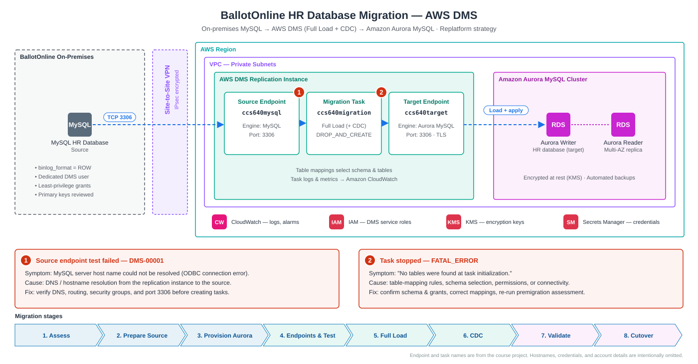

# Database Migration (Replatform)

Full write-up: [`aws-dms/README.md`](aws-dms/README.md)

MySQL HR database → AWS DMS → Amazon Aurora MySQL. The course lab used a Full Load task; Full Load + CDC is the recommended production option ([cutover runbook](../cutover-rollback/cutover-runbook.md#choosing-the-database-cutover-method)).

| Folder | Contents |
|---|---|
| [`mysql/`](mysql/) | [`source-preparation.sql`](mysql/source-preparation.sql): binary logging checks, schema assessment, least-privilege DMS user |
| [`aws-dms/`](aws-dms/) | [Migration write-up](aws-dms/README.md), [`table-mappings.json`](aws-dms/table-mappings.json), [`task-settings.json`](aws-dms/task-settings.json) |
| [`aurora/`](aurora/) | [`validation-queries.sql`](aurora/validation-queries.sql): schema, row-count, and content-hash checks before cutover |
