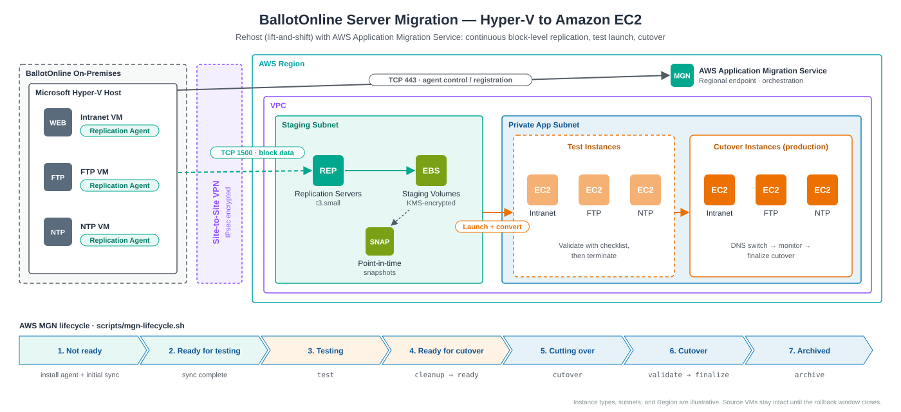

# 🖥️ BallotOnline Server Migration — Hyper-V to AWS



## Overview

This section documents the migration of BallotOnline's **Microsoft Hyper-V** virtual servers to **Amazon EC2** using **AWS Application Migration Service (AWS MGN)**.

The server workloads use a **rehosting (lift-and-shift)** strategy. Each server is replicated at the block level and launched on EC2 without changes to its operating system or applications. This keeps migration risk and effort low; modernization happens after the move (see [Postmigration Optimization](#-postmigration-optimization)).

---

## 🎯 Migration Objective

| | |
|---|---|
| **Source** | Microsoft Hyper-V virtual machines (on-premises) |
| **Target** | Amazon EC2 in private subnets of the BallotOnline VPC |
| **Migration Service** | AWS Application Migration Service (AWS MGN) |
| **Migration Strategy** | Rehost (lift-and-shift) |

### Workloads in Scope

| Server | Role | Protocol / Port | Target Subnet | Notes |
|---|---|---|---|---|
| Intranet | Internal web portal | HTTPS 443 | Private app subnet | Reached by staff over the Site-to-Site VPN |
| FTP | File transfer | SFTP 22 (FTP 21 + passive range if still required) | Private app subnet | Move users to SFTP during migration |
| NTP | Time synchronization | UDP 123 | Private app subnet | Candidate for retirement (Amazon Time Sync Service) |

---

## 🏗️ Migration Architecture

```text
┌──────────────────────────┐
│ On-Premises Hyper-V      │
│ • Intranet Server        │
│ • FTP Server             │
│ • NTP Server             │
│   + AWS Replication Agent│
└────────────┬─────────────┘
             │ TCP 443  → MGN API (control)
             │ TCP 1500 → Replication servers (data)
             │ over Site-to-Site VPN
             ▼
┌──────────────────────────┐
│ AWS MGN Staging Subnet   │
│ • Replication Servers    │
│ • Low-cost EBS volumes   │
│ • Point-in-time snapshots│
└────────────┬─────────────┘
             │ Launch (test → cutover)
             ▼
┌──────────────────────────┐
│ Private App Subnet       │
│ • EC2 Intranet           │
│ • EC2 FTP                │
│ • EC2 NTP                │
└──────────────────────────┘
```

### How AWS MGN Works

1. An **AWS Replication Agent** on each source server copies its disks block by block.
2. Data streams over **TCP 1500** to lightweight **replication servers** in a staging subnet, which write to low-cost EBS volumes.
3. After the **initial sync**, replication becomes **continuous**, so the AWS copy stays seconds behind the source.
4. When a test or cutover instance is launched, MGN converts the replicated volumes (boot loader, drivers, network configuration) so they boot natively on EC2.

---

## 🔄 Migration Workflow

| # | Stage | MGN Lifecycle State |
|---|---|---|
| 1 | Initialize AWS MGN in the target Region | — |
| 2 | Configure replication settings (staging subnet, instance type, EBS encryption) | — |
| 3 | Open network paths (443 and 1500 outbound from the servers) | — |
| 4 | Install the AWS Replication Agent on each server | `NOT_READY` |
| 5 | Wait for initial sync to finish | `NOT_READY` → `READY_FOR_TEST` |
| 6 | Configure launch settings and EC2 launch templates | `READY_FOR_TEST` |
| 7 | Launch **test instances** and validate | `TESTING` |
| 8 | Terminate test instances, mark servers ready | `READY_FOR_CUTOVER` |
| 9 | Maintenance window: stop source services, launch **cutover instances** | `CUTTING_OVER` |
| 10 | Validate, switch DNS, monitor | `CUTOVER` |
| 11 | Finalize cutover (replication stops) | `CUTOVER` (finalized) |
| 12 | Archive source servers after the rollback window | `DISCONNECTED` / archived |

---

## 1. Prerequisites

### AWS Side

- AWS MGN initialized in the target Region (`aws mgn initialize-service`)
- **Staging subnet** for replication servers (see [architecture](../../architecture/migration-architecture.md))
- **Replication settings template**:
  - Replication server instance type: `t3.small` (default)
  - EBS encryption: enabled with AWS KMS
  - Data routing: private IP over the VPN (no public IP on replication servers)
  - Security group: inbound TCP 1500 from the on-premises CIDR only
- IAM credentials for agent installation using the **`AWSApplicationMigrationAgentInstallationPolicy`** managed policy (short-lived, deleted after installation)

### Source Server Side

| Requirement | Detail |
|---|---|
| Outbound TCP 443 | To `mgn.<region>.amazonaws.com` and the MGN S3 bucket for the Region |
| Outbound TCP 1500 | To the replication servers in the staging subnet |
| Free disk space | About 2 GB for the agent |
| Supported OS | Windows Server or a supported Linux distribution |
| Hyper-V VM generation | Generation 1 (BIOS) and Generation 2 (UEFI) are both supported |

---

## 2. Replication Agent Installation

Scripts in [`scripts/`](scripts/) install the agent. Both check connectivity first and read credentials from environment variables, so no keys are stored in files.

| Script | Platform |
|---|---|
| [`install-agent-linux.sh`](scripts/install-agent-linux.sh) | Linux guests |
| [`install-agent-windows.ps1`](scripts/install-agent-windows.ps1) | Windows guests (elevated PowerShell) |

```bash
# Linux example
export AWS_REGION=us-east-1
export AWS_ACCESS_KEY_ID=...  AWS_SECRET_ACCESS_KEY=...   # agent-installation credentials
sudo -E ./scripts/install-agent-linux.sh
```

After installation, each server appears in the MGN console under **Source servers** and begins its initial sync.

---

## 3. Launch Settings

Each server gets an EC2 launch template before testing:

| Setting | Intranet | FTP | NTP |
|---|---|---|---|
| Instance type | Right-sized from source CPU/RAM | Right-sized | `t3.micro` |
| Subnet | Private app subnet (AZ A) | Private app subnet (AZ A) | Private app subnet (AZ A) |
| Security group | `sg-intranet` (443 from VPN) | `sg-ftp` (22 from VPN) | `sg-ntp` (UDP 123 from VPC + VPN) |
| Public IP | None | None | None |
| IAM instance profile | `AmazonSSMManagedInstanceCore` | `AmazonSSMManagedInstanceCore` | `AmazonSSMManagedInstanceCore` |
| EBS | gp3, encrypted (KMS) | gp3, encrypted (KMS) | gp3, encrypted (KMS) |
| Licensing | Bring your own / license-included as applicable | — | — |
| Tags | `Project=BallotOnline`, `BallotOnlineOS=<Linux\|Windows>` | same | same |

Attaching `AmazonSSMManagedInstanceCore` lets the migrated servers be managed through **Systems Manager** (Session Manager, Patch Manager, Inventory) without opening SSH or RDP. The tags let the [monitoring and patching associations](../../monitoring/systems-manager/) find each server.

---

## 4. Test Launch

Test instances run alongside production without affecting the source servers or replication.

```bash
./scripts/mgn-lifecycle.sh status                  # list servers and replication state
./scripts/mgn-lifecycle.sh test    s-<server-id>   # launch test instances
# ... validate with cutover-validation-checklist.md ...
./scripts/mgn-lifecycle.sh cleanup s-<server-id>   # terminate test instances
./scripts/mgn-lifecycle.sh ready   s-<server-id>   # mark ready for cutover
```

Validation steps for each service are in [`cutover-validation-checklist.md`](cutover-validation-checklist.md).

---

## 5. Cutover

```text
Confirm replication is CONTINUOUS with low lag
      ↓
Announce maintenance window
      ↓
Stop services / writes on source servers
      ↓
Launch cutover instances          (mgn-lifecycle.sh cutover)
      ↓
Run validation checklist
      ↓
Update DNS records to the new EC2 private IPs
      ↓
Monitor (CloudWatch alarms, user reports)
      ↓
Finalize cutover                  (mgn-lifecycle.sh finalize)
      ↓
Keep source VMs powered off but intact until the rollback window closes
      ↓
Archive source servers            (mgn-lifecycle.sh archive)
```

> Lower DNS TTLs (for example to 60 seconds) a day before cutover so the switch, and any rollback, takes effect quickly.

---

## ↩️ Rollback

Because rehosting leaves the source VMs untouched, rollback is straightforward until cutover is finalized:

1. Point DNS back to the on-premises servers.
2. Start the services on the source Hyper-V VMs.
3. Stop the EC2 cutover instances (keep them for investigation).
4. Copy back any data written on EC2 during the cutover window (for example, files uploaded to the FTP server).
5. Fix the issue, re-test, and schedule a new cutover. Replication can continue in the meantime.

| Rollback Trigger | Example |
|---|---|
| Service unavailable | Intranet does not load after DNS change |
| Data integrity | Files missing on the FTP server |
| Performance | Response times far above baseline |
| Security | Unexpected open ports or failed hardening checks |

---

## 🔧 Common Issues and Checks

These are the issues to check first when replication or launch does not behave as expected.

| Symptom | Likely Cause | Check |
|---|---|---|
| Agent install fails to register | Outbound 443 blocked, proxy, or DNS | Pre-flight check in install script; `Test-NetConnection` / `/dev/tcp` |
| Replication stuck in `INITIATING` / `STALLED` | TCP 1500 blocked between server and staging subnet | VPN routes, on-premises firewall, staging security group |
| Large replication lag | Limited VPN bandwidth or high disk write rate | Bandwidth throttling setting, schedule initial sync off-hours |
| Test instance fails status checks | Boot or driver issue during conversion | EC2 serial console / system log; confirm OS is supported |
| Service unreachable on test instance | Security group or service bound to old IP | Security group rules; service config referencing old hostname/IP |
| Time drift after migration | Instance still pointing at on-premises NTP | Point clients at Amazon Time Sync (`169.254.169.123`) |

---

## 🔐 Security Considerations

- Agent-installation credentials are short-lived and limited to `AWSApplicationMigrationAgentInstallationPolicy`, and deleted afterwards
- Replication traffic is encrypted in transit and stays on the VPN (no public IPs on replication servers)
- Staging and target EBS volumes encrypted with AWS KMS
- Migrated instances have no public IPs; access is through Systems Manager Session Manager
- Security groups allow only the ports each service needs
- FTP users moved to SFTP so credentials are never sent in clear text
- CloudTrail records all MGN and EC2 API activity

---

## 📈 Postmigration Optimization

| Current (after rehost) | Optimization | Benefit |
|---|---|---|
| EC2 NTP server | Amazon Time Sync Service (`169.254.169.123`, built into every EC2 instance) | Retire a server |
| EC2 FTP server | AWS Transfer Family (SFTP) backed by Amazon S3 | Managed service, durable storage |
| EC2 Intranet server | Auto Scaling group behind an Application Load Balancer across two AZs | High availability |
| Instance sizes copied from source | Right-size with CloudWatch metrics and AWS Compute Optimizer | Lower cost |

---

## 📊 AWS Services Involved

| Service | Role |
|---|---|
| AWS Application Migration Service | Replication, conversion, test and cutover launches |
| Amazon EC2 | Target compute for migrated servers |
| Amazon EBS | Staging and target volumes |
| Amazon VPC / Site-to-Site VPN | Private network path for replication and access |
| AWS KMS | Encryption of staging and target volumes |
| AWS IAM | Agent installation and instance permissions |
| AWS Systems Manager | Post-migration management without SSH/RDP |
| Amazon CloudWatch | Monitoring of migrated instances |

---

## 📁 Files

| File | Purpose |
|---|---|
| [`scripts/install-agent-linux.sh`](scripts/install-agent-linux.sh) | Pre-flight check and agent install on Linux |
| [`scripts/install-agent-windows.ps1`](scripts/install-agent-windows.ps1) | Pre-flight check and agent install on Windows |
| [`scripts/mgn-lifecycle.sh`](scripts/mgn-lifecycle.sh) | Status, test, cutover, finalize, and archive with the AWS CLI |
| [`cutover-validation-checklist.md`](cutover-validation-checklist.md) | Per-server validation for test and cutover launches |

---

## 🎓 Skills Demonstrated

`AWS Application Migration Service` `Amazon EC2` `Rehosting` `Hyper-V` `Block-Level Replication` `Test & Cutover Launches` `Launch Templates` `Network Troubleshooting` `AWS CLI Automation` `Bash` `PowerShell` `Systems Manager` `Rollback Planning`

---

## 👨‍💻 Author

**Thierry A. Oteyami**
Cloud Engineer | Oracle DBA | Software Developer
BallotOnline AWS Cloud Migration Project
